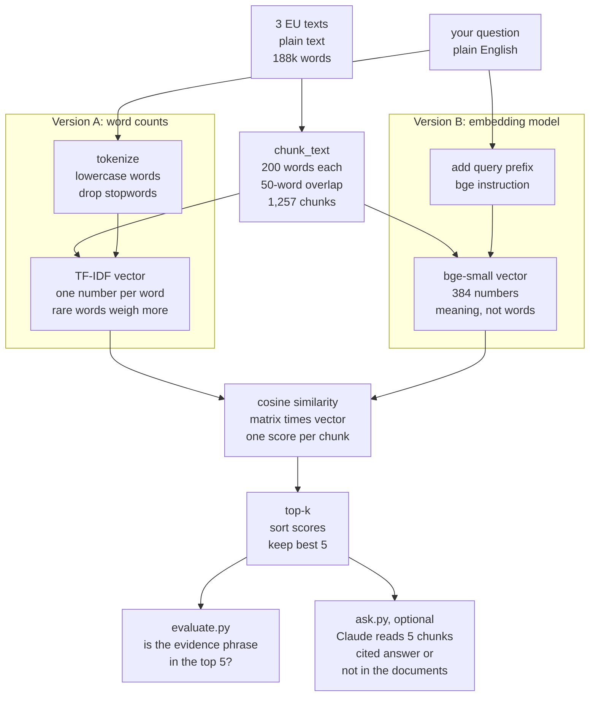

# RAG from scratch on EU sustainability law

> **Part of a series on RAG over EU sustainability law:** **rag-from-scratch** (retrieval built by hand) → [rag-eval](https://github.com/batutho-dot/rag-eval) (measured: three scores and a Claude judge) → [rag-claude-citations](https://github.com/batutho-dot/rag-claude-citations) (API-native: citations and caching)\
> This is part 1, the starting point. Next: [rag-eval](https://github.com/batutho-dot/rag-eval) measures this pipeline end to end.

**Question:** if you ask a plain-English question about EU sustainability reporting rules,
how often does a simple search engine hand back the passage of law that answers it? And
does a small neural embedding model beat a word-counting method written by hand in numpy?

**Answer so far (10 questions, k = 5):**

| Version | How it turns text into numbers | Hit rate at k = 5 |
|---|---|---|
| A | TF-IDF word counts, written by hand in numpy | **6 / 10** |
| B | `BAAI/bge-small-en-v1.5` embedding model on the CPU | **6 / 10** |

Same score, different questions right and wrong (table below). The scores measure retrieval
only. `ask.py` adds the answering half with Claude (see "Ask it a question"); its answers are
tried on 3 questions, not scored.

## The three ideas, in plain words

- **Chunk.** A regulation is far too long to hand to a reader, so each text is cut into
  pieces of 200 words. Each piece overlaps the next by 50 words, so a sentence cut at one
  edge is still whole in the neighbour. The three texts give 1,257 chunks.
- **Embedding (a vector).** Each chunk, and each question, becomes a list of numbers so a
  computer can compare them. Version A uses one number per word in the vocabulary (TF-IDF:
  high when a word is frequent in this chunk and rare elsewhere). Version B uses 384 numbers
  from a small trained model that places texts with similar meaning close together, even
  when they share no words.
- **Top-k.** Compare the question's vector with every chunk's vector (cosine similarity:
  how closely two vectors point the same way) and return the k most similar chunks. Here
  k = 5.

**RAG** (retrieval-augmented generation) is these steps followed by a language model that
answers from only the returned chunks. If the right chunk is not in the top k, the model
never sees it, so retrieval is measured first.

## How it is built

One question's path through the code. Version A and version B differ only in how they turn text into numbers; chunking before the split and top-k after it are shared.



The file-by-file structure, with the line where each box lives, is in [docs/architecture.md](docs/architecture.md).

## Run it

Tested on Python 3.13 (Windows 11). From the repo folder:

```bash
python -m venv .venv
.venv/Scripts/activate        # Windows; on macOS or Linux: source .venv/bin/activate
pip install -r requirements.txt
python run.py
```

`run.py` downloads the three texts from EUR-Lex into `data/` (about 6 MB of HTML), builds
both indexes, scores both, prints every question with the rank where its answer was found,
and writes `results/latest.json`. The first run also downloads the embedding model (a
quantised ONNX copy, about 65 MB, cached by `fastembed`). No GPU, no API key, no cost.
`python -m rag.evaluate --only a` runs the numpy version alone in under a second.
`python verify.py` checks the code after a change (about 1 second; `--full` adds version B,
about 2 minutes) and ends with `verify: PASS` or `verify: FAIL at <step>`. What each step
covers is in `verify-features/`.

On Windows the model download may print a warning about symlinks; it is harmless.

## Data

| Key | Text | CELEX | Words |
|---|---|---|---|
| `taxonomy` | Regulation (EU) 2020/852, the EU Taxonomy Regulation | 32020R0852 | 18,379 |
| `csrd` | Directive (EU) 2022/2464, the Corporate Sustainability Reporting Directive | 32022L2464 | 39,408 |
| `esrs` | Commission Delegated Regulation (EU) 2023/2772, ESRS set 1 | 32023R2772 | 130,571 |

The texts are the versions as published in the Official Journal, fetched as HTML from
`https://eur-lex.europa.eu/legal-content/EN/TXT/HTML/?uri=CELEX:<number>`. They are not
stored in this repo; `run.py` downloads them.

## The test set

`questions.json` holds 10 questions, 3 on the Taxonomy, 4 on the CSRD, 3 on the ESRS. Each
carries the exact words of the law that answer it (`evidence`) and where they sit
(`where`). A question is a **hit** when any of the top 5 chunks contains its evidence
phrase. The script first checks that every evidence phrase exists in the downloaded text,
so a broken test fails loudly instead of scoring zero.

| # | Question | A rank | B rank |
|---|---|---|---|
| q01 | What are the environmental objectives of the EU Taxonomy? | >10 | 3 |
| q02 | Which international guidelines do the Taxonomy's minimum safeguards refer to? | 1 | 1 |
| q03 | When is an economic activity considered to do significant harm to climate change mitigation? | 1 | 1 |
| q04 | What two kinds of information must a company's sustainability reporting cover under the CSRD? | >10 | >10 |
| q05 | From which financial year must large public-interest entities with more than 500 employees report under the CSRD? | 3 | 9 |
| q06 | By what date must the Commission adopt standards for reasonable assurance of sustainability reporting? | 1 | 5 |
| q07 | In what digital format does the management report with the sustainability statement have to be prepared? | >10 | >10 |
| q08 | How long is the medium-term time horizon in the ESRS? | 1 | 5 |
| q09 | Which information must a company always disclose, whatever its materiality assessment finds? | 1 | 8 |
| q10 | Which ESRS disclosure requirement asks for a company's Scope 1, 2 and 3 greenhouse gas emissions? | 6 | 4 |

Hit rate at other depths, same run:

| Version | k = 1 | k = 3 | k = 5 | k = 10 |
|---|---|---|---|---|
| A, TF-IDF | 5 | 6 | 6 | 7 |
| B, bge-small | 2 | 3 | 6 | 8 |

Reading it: A is sharper when the question repeats the law's own words ("minimum
safeguards", "medium-term time horizon"): 5 of 10 at rank 1. B finds paraphrased questions
that A misses completely (q01, q10) but rarely puts the answer first: 2 of 10 at rank 1.

## What it gets wrong, and why

**q07 (digital format), both versions miss, and the miss is partly the test's fault.**
Version A's first result is chunk `csrd#0078`, recital text that says undertakings "should
therefore be required to prepare their management report in the electronic reporting format
specified in Article 3 of Commission Delegated Regulation (EU) 2019/815". That answers the
question. The test only accepts the operative article (new Article 29d(1)), so it is scored
a miss. A test set that allows several accepted passages per question would score it a hit.

**q04 (the two kinds of information), both versions miss, a real failure.** The answer is
the CSRD's "double materiality" sentence: information on the company's impacts on
sustainability matters, and on how sustainability matters affect the company. The question
says "two kinds of information", words the law does not use, and the ESRS discusses impacts
and materiality in hundreds of places. ESRS makes up 871 of the 1,257 chunks (69 percent),
so ESRS chunks crowd the top of the list for both versions.

## Limits

- 10 questions is a small test. One question is 10 percentage points; the A versus B tie
  says nothing about which is better in general.
- I wrote the questions knowing the texts, so some reuse the law's wording. That favours
  version A. Questions from people who have not read the law would likely favour B.
- One accepted passage per question (see q07).
- Fixed 200-word chunks ignore article boundaries, and the ESRS tables are flattened to
  plain lines.
- Texts as originally published in the Official Journal. Later amendments are not
  included, so an answer such as q05 reflects the 2022 text, which may differ from the law
  in force today.
- The hit rates measure retrieval only. Answers from `ask.py` are not scored yet.

## Ask it a question

`ask.py` is the full RAG loop: it retrieves the top 5 chunks (version B by default), sends
only those to Claude with the instruction to answer from them alone, cite the chunk ids, and
reply "not in the documents" when the passages do not hold the answer. It prints the
answer, the chunks it sent, and the tokens and cost of the call, and appends each call to
`results/ask_log.jsonl`.

It needs an Anthropic API key in the `ANTHROPIC_API_KEY` environment variable (on Windows a
saved user variable is picked up). After `python run.py` has downloaded the texts:

```bash
python ask.py "What are the environmental objectives of the EU Taxonomy?"
python ask.py -i                     # ask several questions; empty line quits
python ask.py --model sonnet "..."   # Claude Sonnet 5.5 instead of Claude Haiku 5.5
python ask.py --retriever a "..."    # TF-IDF retrieval instead of embeddings
```

The first call with version B embeds all chunks (about 3 minutes on a laptop CPU) and caches
them in `data/cache/`; later calls start in about a second.

Tried on 3 of the 10 test questions with Claude Haiku 5.5 (2026-11-19, effort `low`):

| Question | Retrieved the answer? | Answer | Tokens in / out | Cost |
|---|---|---|---|---|
| q01 environmental objectives | yes (`taxonomy#0058`, Article 9) | Right: all six objectives, cited | 2,380 / 162 | $0.00032 |
| q04 two kinds of information (CSRD) | no | Wrong: answered "forward-looking and retrospective, qualitative and quantitative" from a recital, instead of the double materiality pair; flagged that the passage only says "should" | 2,380 / 461 | $0.00047 |
| q07 digital format | the recital, not the article | Right: the format in Article 3 of Delegated Regulation (EU) 2019/815, cited | 2,421 / 124 | $0.00030 |

Total for the 3 calls: $0.00109, using Anthropic's list prices of $0.10 per million input
tokens and $0.50 per million output tokens for Claude Haiku 5.5 (model table dated
2026-11-03). Output tokens include the model's hidden reasoning.

q04 shows the main risk of RAG: when retrieval misses, the model does not say "not in the
documents". It answers a nearby question from whatever passage it was given. That is a
retrieval failure that turns into a wrong answer, and it is what the next project measures.

## Next

Planned follow-ups on the same corpus: a test set with questions the texts cannot answer
and several accepted passages per question, then cited answers from a language model.

## Source and credit

EU legal texts: © European Union, https://eur-lex.europa.eu. EUR-Lex's legal notice states
that, unless otherwise specified, its legal documents may be re-used for commercial or
non-commercial purposes, under the Commission's reuse policy (Decision 2011/833/EU):
https://eur-lex.europa.eu/content/legal-notice/legal-notice.html (checked 2026-11-19). Only
the official Official Journal texts are authentic; this tool is not legal advice.

Embedding model: `BAAI/bge-small-en-v1.5` by BAAI, run through
[fastembed](https://github.com/qdrant/fastembed). Model card:
https://huggingface.co/BAAI/bge-small-en-v1.5

Code: MIT licence, see `LICENSE`.
