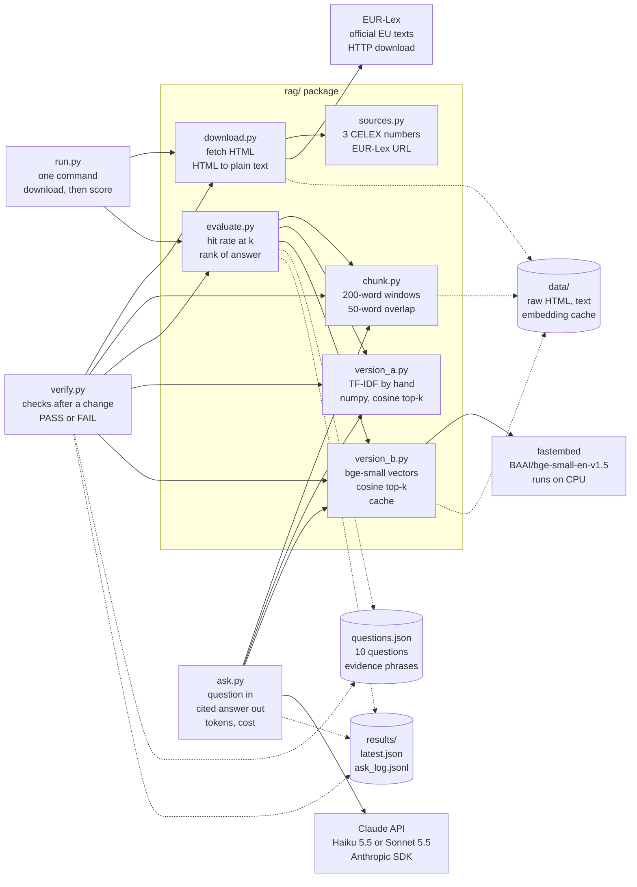
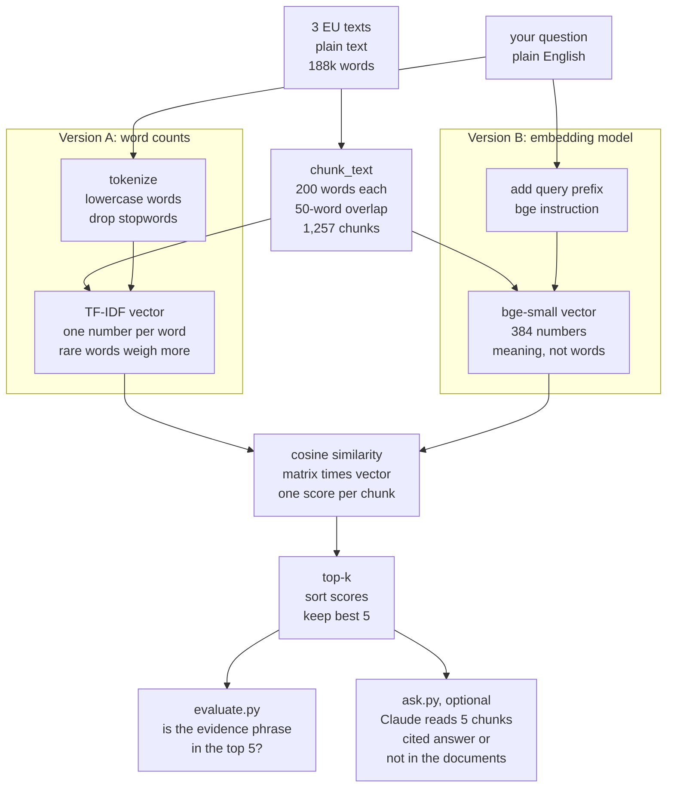

# How the code fits together

Two pictures of the same code. (a) shows which file uses which; (b) follows one question
from text to answer. Every box and arrow matches the code at the line given in the tables.

## (a) Structure: files, and who calls whom

Solid arrows are imports and calls. Dotted arrows are files read or written. The three
boxes on the right are outside this repo.

| Box | Where | What it does |
|---|---|---|
| run.py | `run.py:9` | Calls `download.main()` and then `evaluate.main()`, so one command does everything. |
| ask.py | `ask.py:126` | Loads the chunks, builds a retriever, asks Claude, prints and logs each answer. |
| verify.py | `verify.py:120` | Runs the checks in order and stops at the first failure. |
| sources.py | `rag/sources.py:11` | Lists the three texts by CELEX number; `url()` at line 27 builds the EUR-Lex address. |
| download.py | `rag/download.py:46` | Downloads each text once into `data/raw/`, then writes plain text to `data/text/`. |
| chunk.py | `rag/chunk.py:24` | Cuts one text into 200-word chunks that overlap by 50 words; `load_chunks` at line 33 does all three texts. |
| version_a.py | `rag/version_a.py:23` | Builds the TF-IDF matrix by hand in numpy and searches it. |
| version_b.py | `rag/version_b.py:18` | Turns each chunk into 384 numbers with the bge-small model, saves them, and searches them. |
| evaluate.py | `rag/evaluate.py:50` | Builds both indexes, asks the 10 questions, and writes the hit rates to `results/latest.json`. |
| questions.json | `questions.json` | The 10 test questions, each with the exact words of the law that answer it. |
| EUR-Lex | `rag/download.py:53` | The only network call for the texts (`urllib.request.urlopen`). |
| fastembed | `rag/version_b.py:24` | Loads the embedding model; it downloads about 65 MB on the first run. |
| Claude API | `ask.py:88`, `ask.py:92` | Sonnet goes through the beta call with fallback; Haiku through the plain call. |

## (b) The path of one question

Everything above the split happens once per run. The split is the only place where
version A and version B differ; after it both do the same thing.

| Box | Where | What it does |
|---|---|---|
| chunk_text | `rag/chunk.py:24` | Slides a 200-word window along the text, moving 150 words each step. |
| tokenize | `rag/version_a.py:19` | Lowercases the text, keeps letters and digits, drops a short stopword list. |
| TF-IDF vector | `rag/version_a.py:30`, `rag/version_a.py:42` | Weighs each word by how rare it is across chunks, damps repeats with log, scales to length 1. |
| query prefix | `rag/version_b.py:41` | Puts the instruction sentence the bge model expects in front of the question. |
| bge-small vector | `rag/version_b.py:30` | The model turns each chunk into 384 numbers, scaled to length 1. |
| cosine similarity | `rag/version_a.py:48`, `rag/version_b.py:42` | One matrix multiplication gives a similarity score for every chunk at once. |
| top-k | `rag/version_a.py:49`, `rag/version_b.py:43` | Sorts the scores and keeps the indexes of the best k. |
| evaluate.py | `rag/evaluate.py:30` | Walks down the ranked chunks and records the rank of the first one holding the evidence phrase. |
| ask.py | `ask.py:75` | Sends the 5 chunks and the question to Claude with the answer-only-from-these rules (`ask.py:39`). |
